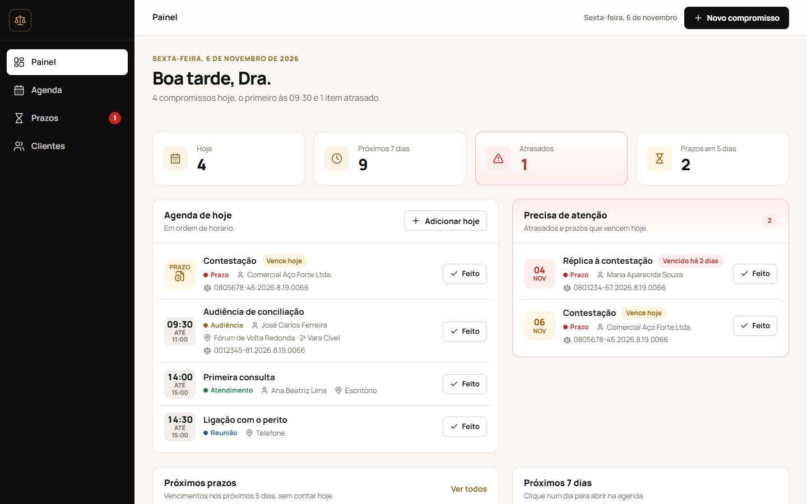
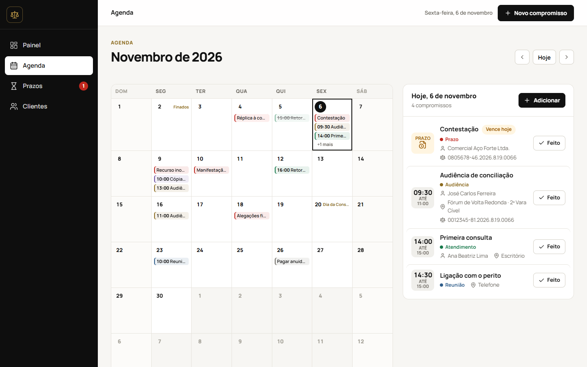
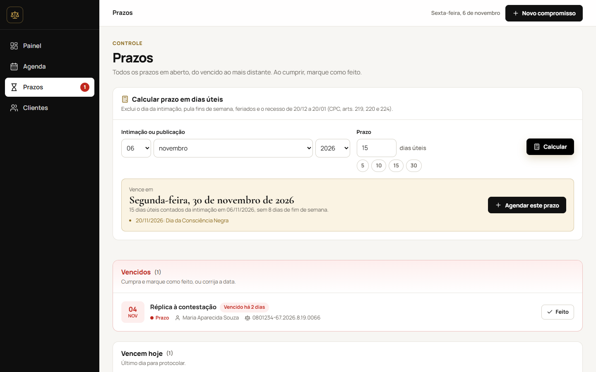
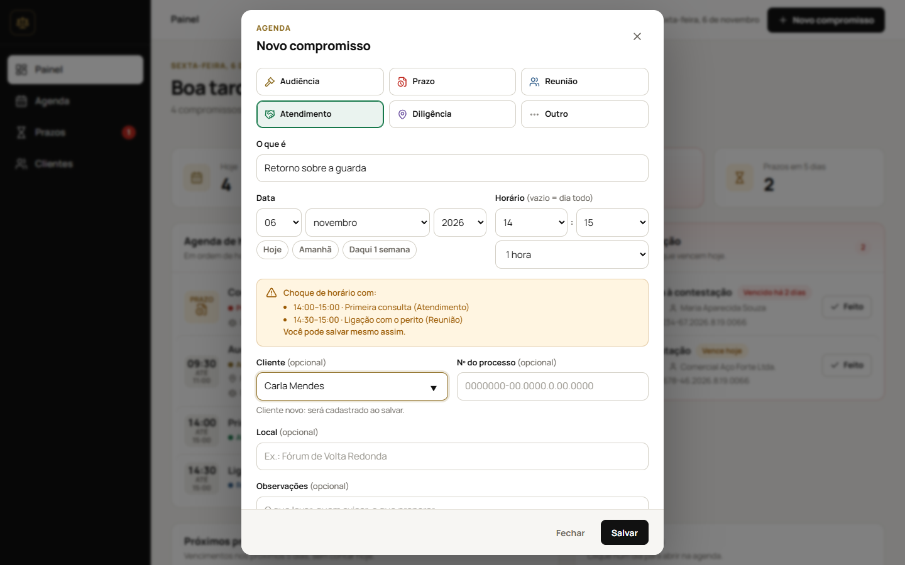
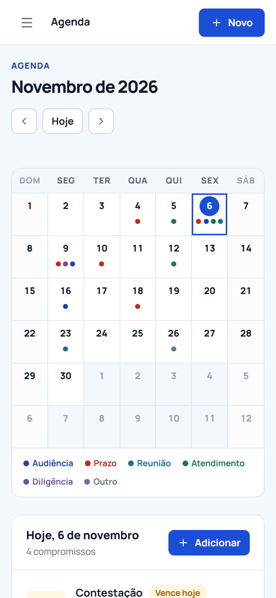

# Pauta · Agenda jurídica

Agenda para advogada que trabalha sem secretária: audiências, prazos, reuniões e clientes num só painel, com prazo contado em dias úteis e alerta do que está vencendo.

[](https://github.com/Tutzdev/pauta-agenda-juridica/actions/workflows/ci.yml)




## O que faz

- **Painel do dia:** o que tem hoje em ordem de horário, o que ficou atrasado, os prazos dos próximos dias e a carga da semana.
- **Agenda do mês:** calendário com feriados e recesso marcados. Dois cliques num dia criam um compromisso.
- **Prazos em dias úteis:** informe a data da intimação e o número de dias; a Pauta devolve o vencimento, mostra o que foi pulado (fins de semana, feriados, recesso) e já agenda o prazo.
- **Aviso de choque de horário:** ao marcar algo, avisa se bate com outro compromisso em aberto.
- **Clientes:** cadastro com busca por nome ou telefone, WhatsApp e ligação a um clique e o histórico de cada um na agenda. Cliente novo é cadastrado só de digitar o nome no compromisso.
- **Número de processo conferido:** padrão CNJ com validação dos dígitos verificadores. Um número digitado errado é recusado na hora.
- **Feito com desfazer**, atalho **N** para novo compromisso, e funciona no celular.

| Agenda | Prazos |
| --- | --- |
|  |  |

| Novo compromisso | Celular |
| --- | --- |
|  |  |

## Como rodar

Precisa só do **Java 21**. O banco (H2) fica em arquivo na pasta `data/`, no próprio computador.

```bash
./mvnw spring-boot:run
```

Abra **http://localhost:8080**. Para ver a agenda já preenchida com dados de exemplo (num banco separado):

```bash
./mvnw spring-boot:run -Dspring-boot.run.profiles=demo
```

Para gerar o executável e rodar sem o Maven:

```bash
./mvnw package
java -jar target/pauta.jar
```

## Configuração

Tudo por variável de ambiente, com padrões prontos para uso local.

| Variável | Padrão | Para quê |
| --- | --- | --- |
| `PAUTA_ADVOGADA` | `Dra.` | Como a saudação chama a advogada: "Boa tarde, Dra." |
| `PAUTA_DIAS_ALERTA` | `5` | Prazos que vencem em até N dias aparecem como próximos |
| `PAUTA_FERIADOS_LOCAIS` | `04-23,07-17` | Feriados estaduais e municipais (`MM-dd`). Padrão: RJ e Volta Redonda |
| `PAUTA_RECESSO` | `true` | Recesso forense de 20/12 a 20/01 suspende a contagem |
| `PAUTA_ADDRESS` | `127.0.0.1` | Só este computador acessa. Use `0.0.0.0` para liberar na rede |
| `PAUTA_PORT` | `8080` | Porta |
| `DB_URL`, `DB_USERNAME`, `DB_PASSWORD` | H2 em `./data/pauta` | Troque por PostgreSQL quando quiser (`jdbc:postgresql://…`) |

## Regras de prazo

| Regra | Base |
| --- | --- |
| Conta só dias úteis | CPC, art. 219 |
| Exclui o dia da intimação e inclui o do vencimento; começa no primeiro dia útil seguinte | CPC, art. 224 |
| Suspende entre 20 de dezembro e 20 de janeiro | CPC, art. 220 |
| Feriados nacionais fixos, Carnaval, Sexta-feira Santa e Corpus Christi (calculados pela Páscoa) | Lei 662/1949, Lei 14.759/2023 |
| Feriados locais configuráveis | `PAUTA_FERIADOS_LOCAIS` |

Suspensões extraordinárias do tribunal (falha no sistema, ponto facultativo) não entram na conta: confira sempre o calendário do TJ.

## Arquitetura

Monólito modular em Spring Boot, organizado por funcionalidade. A interface (HTML, CSS e JavaScript sem build) é servida pela própria aplicação: um único `.jar` roda tudo.

```text
src/main/java/dev/tutz/pauta
├── appointment/  # compromissos, máquina de estados, alertas, choque de horário, número CNJ
├── client/       # clientes, telefone normalizado, busca
├── deadline/     # calendário forense, feriados, Páscoa, contagem em dias úteis
├── dashboard/    # resumo do painel
├── office/       # nome do escritório, da advogada e o "hoje" do servidor
├── demo/         # dados de exemplo (perfil demo)
└── shared/       # Clock, erros em problem+json, cabeçalhos de segurança
```

- **Regras no domínio:** `Appointment` só aceita transições válidas (em aberto → feito/cancelado → reaberto); `ProcessNumber`, `PhoneNumber` e `TimeSlot` são value objects que se validam na criação.
- **Tempo controlado:** um `Clock` no fuso `America/Sao_Paulo` é injetado em tudo; os testes fixam o "hoje".
- **Sem dependência circular:** o cadastro de clientes define a interface `ClientSchedule` e a agenda a implementa.
- **Banco versionado:** migrações Flyway; o Hibernate só valida o esquema.
- **Erros padronizados:** respostas `application/problem+json` (RFC 9457) com um `code` estável (`INVALID_PROCESS_NUMBER`, `CLIENT_HAS_APPOINTMENTS`…).
- **Segurança:** escuta só em `127.0.0.1`, CSP restrita à própria origem, fontes servidas localmente (nada sai para terceiros) e nenhum HTML montado com dado sem escape.

## API

| Recurso | Rotas |
| --- | --- |
| Compromissos | `GET /api/appointments?from=&to=` · `GET /api/appointments?clientId=` · `GET /api/appointments/deadlines` · `GET /api/appointments/conflicts?date=&startTime=&durationMinutes=` |
| | `POST /api/appointments` · `PUT /api/appointments/{id}` · `POST /api/appointments/{id}/complete` · `/cancel` · `/reopen` · `DELETE /api/appointments/{id}` |
| Clientes | `GET /api/clients?search=` · `GET /api/clients/{id}` · `POST /api/clients` · `PUT /api/clients/{id}` · `DELETE /api/clients/{id}` |
| Prazos | `GET /api/deadlines/calculate?startDate=&businessDays=` · `GET /api/deadlines/closed-days?from=&to=` |
| Painel | `GET /api/dashboard` · `GET /api/office` |

## Testes

```bash
./mvnw test
```

77 testes: unidade (contagem de prazo, feriados e Páscoa, dígitos do CNJ, choque de horário, transições, alertas) e integração com a aplicação inteira, migrações Flyway e MockMvc.
